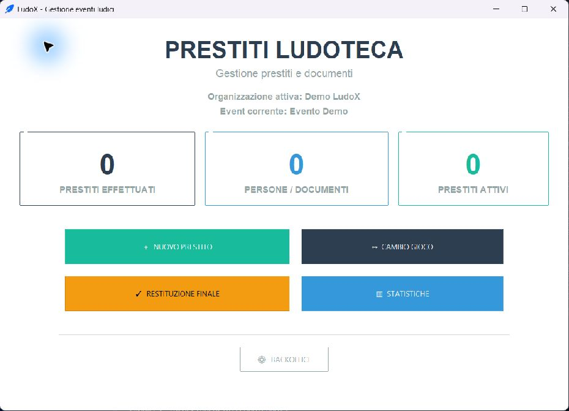
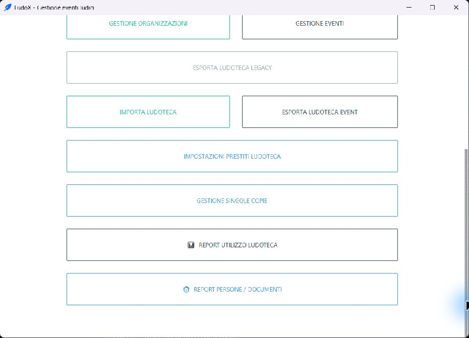
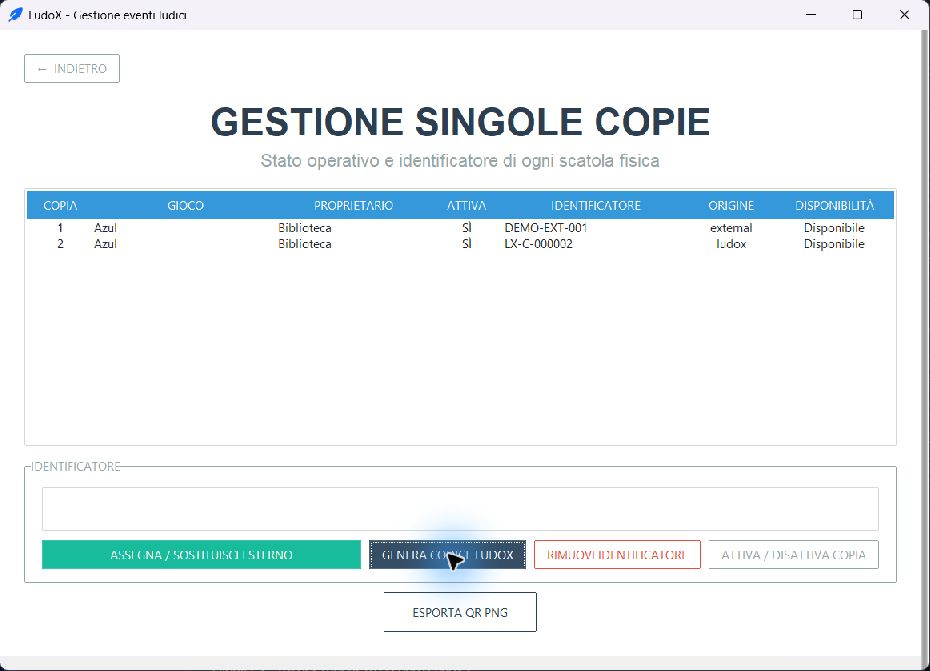
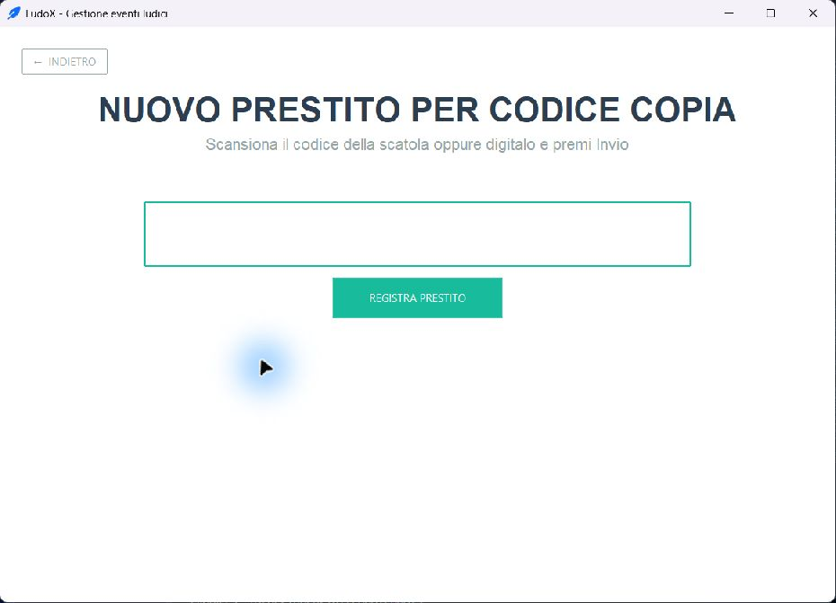

# LudoX — Guida rapida

**Versione candidata 0.2.0-alpha**

LudoX è un'applicazione locale per gestire il prestito di giochi durante un
evento. La postazione lavora su un file database scelto dall'operatore e non
richiede una connessione di rete.

Questa guida accompagna dalla prima configurazione alla chiusura del banco. Le
due modalità disponibili sono alternative:

- **token**: la persona riceve un token numerato, collegato alla posizione del
  documento custodito;
- **identificatore copia** (`copy_identifier`): l'operatore legge il codice
  della singola scatola e LudoX assegna soltanto una posizione al documento.

> **Versione alpha**
>
> Prima di un evento reale, esegui una prova completa con un database di test,
> controlla il materiale fisico e verifica la modalità scelta per l'Event.

## 1. Primo avvio e database

Al primo avvio scegli:

1. la **lingua**;
2. il file **database**;
3. **SALVA CONFIGURAZIONE E AVVIA**.

Puoi usare **NUOVO…** per creare un database oppure **APRI ESISTENTE…** per
selezionarne uno già disponibile. Un database nuovo viene preparato
automaticamente. La quantità di posizioni non si imposta in questa schermata:
è una configurazione specifica della ludoteca di ciascun Event.

Il database contiene configurazioni, cataloghi, prestiti e storico. Conservalo
in una cartella nota e sottoposta a backup.

## 2. Organization, Event e Game Library

Ogni operazione avviene nel contesto seguente:

```text
database/workspace → Organization → Event → Game Library
```

- una **Organization** rappresenta l'organizzazione che gestisce gli eventi;
- un **Event** è una specifica manifestazione o sessione operativa;
- la **Game Library** è il modulo di prestito dell'Event.

Giochi, proprietari, copie, modalità operativa, prestiti e statistiche della
Game Library appartengono all'Event corrente. Event diversi nello stesso
database mantengono quindi ludoteche separate.

### Preparare il primo Event

1. Dalla Home apri **BACKOFFICE**.
2. Inserisci la password iniziale `ludox` e premi **ACCEDI**.
3. Apri **GESTIONE ORGANIZZAZIONI**, crea l'Organization e rendila corrente.
4. Apri **GESTIONE EVENTI** e crea l'Event con nome, date, orari, fuso orario e
   stato.
5. Nella configurazione dell'Event abilita **Prestiti Ludoteca** (Game
   Library).
6. Torna alla Home e verifica che Organization ed Event corretti siano
   indicati in alto.

Se esistono più Event selezionabili, usa **CAMBIA EVENT**. Cambiare Event cambia
anche la ludoteca e i dati operativi visualizzati.



*Home della release candidata con il contesto operativo selezionato.*

## 3. Preparare la ludoteca dell'Event

Nel Backoffice, le funzioni della ludoteca diventano disponibili soltanto
quando l'Event corrente ha la Game Library abilitata.

### Impostazioni della ludoteca

Apri **IMPOSTAZIONI PRESTITI LUDOTECA** e configura:

- **numero di posizioni**: deve corrispondere alle posizioni fisiche in cui
  custodirai i documenti;
- **modalità operativa**: `token` oppure `copy_identifier`.

La modalità può essere cambiata soltanto quando non ci sono sessioni o prestiti
aperti. Anche la riduzione delle posizioni viene bloccata se renderebbe non
valida una sessione ancora attiva.

### Proprietari, giochi e quantità

1. In **GESTIONE PROPRIETARI** inserisci le etichette dei proprietari dei
   giochi, per esempio `Associazione`, `Biblioteca` o un nome concordato.
2. In **GESTIONE GIOCHI** crea i titoli e assegna le copie ai proprietari.
3. Controlla quantità, copie disponibili e stato attivo dei giochi.

I proprietari dei giochi sono semplici etichette della ludoteca e non sono le
Organization.



*Il Backoffice raccoglie configurazione, catalogo, import/export e report.*

## 4. Singole copie e codici

Apri **GESTIONE SINGOLE COPIE** per vedere ogni scatola fisica con gioco,
proprietario, stato e identificatore. Una copia può non avere un codice oppure
avere un solo `copy_identifier`.

I codici sono di due tipi:

- **external**: barcode, QR o altro codice già presente sulla scatola;
- **ludox**: codice creato da LudoX, per esempio `LX-C-000001`.

Il codice identifica una copia soltanto all'interno dello stesso Event. Non
crea un'identità globale tra Event diversi.

### Assegnare o sostituire un codice external

1. Seleziona la copia.
2. Porta il cursore nel campo del codice.
3. Leggi il codice con lo scanner oppure digitalo.
4. Premi **Invio** o usa **ASSEGNA / SOSTITUISCI ESTERNO**.

Il confronto è esatto: dopo la rimozione degli spazi iniziali e finali,
maiuscole e minuscole restano differenti. Evita quindi varianti dello stesso
codice.

### Generare ed esportare un QR LudoX

1. Seleziona una copia senza codice.
2. Usa **GENERA CODICE LUDOX**.
3. Usa **ESPORTA QR PNG** e scegli dove salvare l'immagine.
4. Stampa l'immagine e applicala alla scatola corretta.

L'esportazione QR è disponibile per i codici generati da LudoX. Un codice
external rimane quello applicato e gestito dalla sorgente esterna.

Non rimuovere o sostituire un identificatore mentre la relativa copia è in
prestito. Prima di stampare molte etichette, prova la lettura di un QR e
controlla che restituisca esattamente il valore mostrato da LudoX.



*Due copie dello stesso gioco con identificatori di origine diversa.*

## 5. Importare ed esportare il catalogo

Usa **IMPORTA LUDOTECA** ed **ESPORTA LUDOTECA EVENT** per trasferire il
catalogo dell'Event in formato CSV o XLSX. L'importazione mostra un'anteprima:
controllala prima di confermare, perché eventuali errori bloccano l'intero
file.

Le colonne supportate sono:

| Colonna | Contenuto |
| --- | --- |
| `game_name` | Titolo del gioco |
| `owner_label` | Proprietario della copia |
| `quantity` | Quantità della riga |
| `copy_identifier` | Codice opzionale della singola copia |
| `identifier_source` | `external` oppure `ludox` |

Regole principali:

- una riga con `copy_identifier` rappresenta una sola scatola e richiede
  `quantity = 1`;
- senza identificatore, `quantity` può essere maggiore di 1;
- un identificatore senza sorgente viene importato come `external`;
- un codice duplicato nello stesso Event rende il file non valido;
- export e successivo import conservano codice e sorgente delle copie
  identificate.

Se la colonna del proprietario manca, LudoX chiede un proprietario comune per
le righe importate. Il vecchio export legacy serve soltanto per compatibilità
con cataloghi precedenti; per il lavoro corrente usa l'export dell'Event.

## 6. Preparare il banco prestiti

Per entrambe le modalità servono:

- un PC con LudoX e il database corretto;
- uno schedario o contenitore con posizioni numerate;
- una postazione custodita, non accessibile al pubblico;
- una posizione fisica per ogni numero configurato nell'Event.

Il registro è anonimo: LudoX non richiede il nome della persona né il numero
del documento. Custodisci comunque i documenti fuori dalla vista del pubblico.

In modalità `token` servono anche token fisici numerati. In modalità
`copy_identifier`, applica un codice a ogni copia che verrà prestata e collega
lo scanner HID al PC.

Uno scanner HID si comporta come una tastiera:

```text
codice → Invio
```

Non richiede rete, webcam o fotocamera. Ogni schermata di scansione può essere
provata anche digitando manualmente il codice e premendo **Invio**. Configura lo
scanner perché invii automaticamente Invio dopo il codice.

## 7. Operazioni in modalità token

La regola fisica è sempre:

```text
token N = posizione N del documento
```

### Nuovo prestito

1. Ricevi il documento.
2. Dalla Home premi **NUOVO PRESTITO** e scegli il gioco.
3. LudoX assegna il primo token libero.
4. Metti il documento nella posizione con lo stesso numero.
5. Consegna alla persona il token e il gioco.
6. Conferma l'operazione mostrata a schermo.

### Cambio gioco

1. Ricevi il gioco restituito e il token.
2. Premi **CAMBIO GIOCO** e inserisci il numero del token.
3. Verifica il gioco corrente e scegli quello nuovo.
4. Completa il cambio e consegna il nuovo gioco.

Il documento resta nella stessa posizione e la persona conserva lo stesso
token.

### Restituzione finale

1. Ricevi il gioco e il token.
2. Premi **RESTITUZIONE FINALE** e inserisci il numero del token.
3. Verifica il gioco restituito.
4. Recupera il documento dalla posizione indicata.
5. Restituisci fisicamente il documento.
6. Solo allora premi **DOCUMENTO RESTITUITO**.

La sessione si chiude e token, posizione e copia tornano disponibili.

## 8. Operazioni in modalità identificatore copia

In questa modalità non si consegna alcun token fisico. La persona riceve il
gioco; LudoX conserva il collegamento tra copia prestata e posizione del
documento.

### Nuovo prestito

1. Ricevi il documento.
2. Premi **NUOVO PRESTITO**.
3. Leggi il codice della copia con lo scanner oppure digitalo e premi
   **Invio**.
4. LudoX assegna una posizione libera.
5. Metti il documento nella posizione indicata.
6. Conferma e consegna il gioco.

### Cambio gioco

1. Ricevi la copia restituita.
2. Premi **CAMBIO GIOCO** e leggi il suo codice.
3. Leggi il codice della nuova copia.
4. Controlla il riepilogo e conferma.
5. Consegna il nuovo gioco.

La stessa sessione e la stessa posizione del documento rimangono attive. Se
annulli prima della conferma, il cambio non viene registrato.

### Restituzione finale

1. Ricevi la copia restituita.
2. Premi **RESTITUZIONE FINALE** e leggi il suo codice.
3. Recupera il documento dalla posizione mostrata.
4. Restituisci fisicamente il documento.
5. Solo allora premi **DOCUMENTO RESTITUITO**.

La sessione si chiude e la copia e la posizione tornano disponibili.



*Lo scanner HID e la tastiera usano lo stesso campo: codice seguito da Invio.*

## 9. Statistiche, storico e Backoffice

La Home mostra i contatori dell'Event corrente: prestiti effettuati,
persone/documenti e prestiti attivi. **STATISTICHE** mostra i giochi più
prestati dello stesso Event.

Nel Backoffice sono disponibili, tra le altre, queste viste:

- **TUTTI I PRESTITI**: storico dei movimenti;
- **DOCUMENTI / PERSONE**: sessioni aperte e concluse;
- **GIOCHI PER PROPRIETARIO**: composizione della ludoteca;
- **REPORT UTILIZZO LUDOTECA**: utilizzo delle copie;
- **REPORT PERSONE / DOCUMENTI**: riepilogo delle sessioni;
- gestioni di Organization, Event, giochi, proprietari e singole copie.

Quando disponibile, lo storico mostra identificatore e proprietario della
copia. Per vecchi prestiti in modalità token questi dettagli possono risultare
non disponibili. Usa i filtri e i report per il controllo operativo; non
modificare manualmente il database.

## 10. Cambiare workspace e migration

Da **BACKOFFICE → IMPOSTAZIONI** puoi cambiare lingua e database. Usa
**NUOVO…** o **APRI ESISTENTE…**, quindi salva. Ogni database è un workspace
separato: passando a un altro file cambiano Organization, Event, cataloghi,
prestiti e storico visibili.

Prima del cambio:

1. completa le restituzioni finali;
2. verifica che i prestiti attivi siano zero;
3. conserva una copia di sicurezza del database importante.

LudoX impedisce il cambio se nel workspace corrente ci sono sessioni aperte.
Se l'apertura del nuovo workspace non riesce o viene annullata, resta valido il
workspace precedente.

Quando un database esistente usa una versione precedente, LudoX chiede il
consenso per la **migration** prima di renderlo operativo. Se autorizzi:

1. crea automaticamente un backup accanto al database originale;
2. applica in ordine gli aggiornamenti necessari;
3. apre il workspace soltanto se l'aggiornamento termina correttamente.

Se rifiuti, il backup non riesce o la migration fallisce, LudoX non usa il
database incompatibile. Non interrompere il processo e non eliminare il backup
finché non hai verificato cataloghi e storico. Un database creato da una
versione più recente non viene retrocesso.

## 11. Chiusura e controlli finali

Se chiudi LudoX con sessioni aperte, compare un avviso. I dati restano nel
database e saranno ancora presenti al riavvio, ma devi sempre confrontarli con
i documenti e i giochi fisici.

A fine evento:

1. porta **PRESTITI ATTIVI** a zero;
2. verifica che nello schedario non siano rimasti documenti;
3. controlla token e posizioni, se usi la modalità token;
4. esporta i report o il catalogo necessari;
5. esegui il backup del database e chiudi LudoX.

## 12. Problemi comuni

### Le azioni di prestito sono disabilitate

Seleziona un Event con Game Library abilitata.

### Un gioco o una copia non è disponibile

Controlla che sia attivo, assegnato al proprietario corretto e non già in
prestito.

### Il codice non viene riconosciuto

Controlla Event corrente, caratteri maiuscoli/minuscoli e Invio finale. Prova a
digitare manualmente il valore mostrato in Gestione singole copie.

### Non posso sostituire o rimuovere un codice

La copia potrebbe essere in prestito. Completa prima la restituzione finale.

### Non posso cambiare modalità o numero di posizioni

Chiudi tutte le sessioni e i prestiti dell'Event.

### Non posso cambiare database

Completa le sessioni ancora aperte nel workspace corrente.

### LudoX propone una migration

Verifica di aver scelto il file corretto, chiudi le altre applicazioni che
potrebbero usarlo e autorizza soltanto se puoi conservare il backup creato.

## Segnalare un problema

Il progetto è disponibile su <https://github.com/ludox-events/ludox>.

Indica la versione `0.2.0-alpha`, il sistema operativo, l'operazione eseguita,
il risultato atteso e quello osservato. Non allegare database reali o immagini
con dati che non vuoi condividere.
